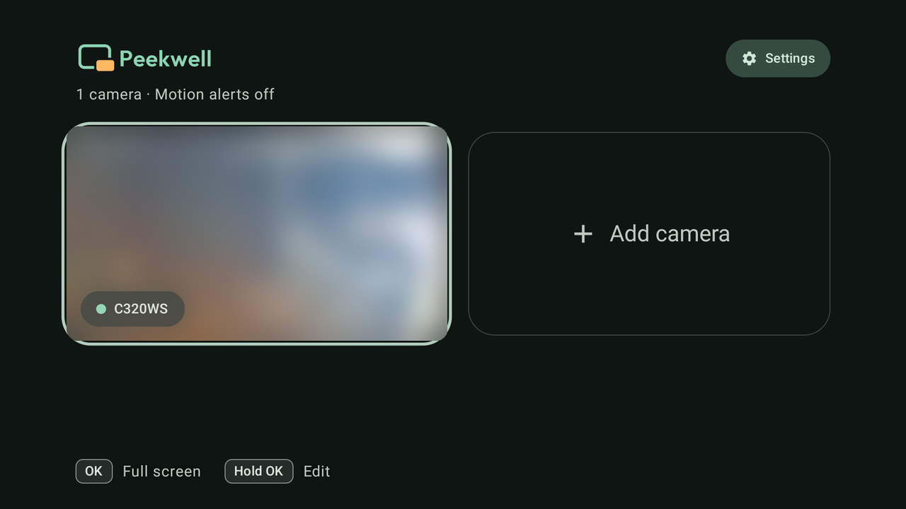
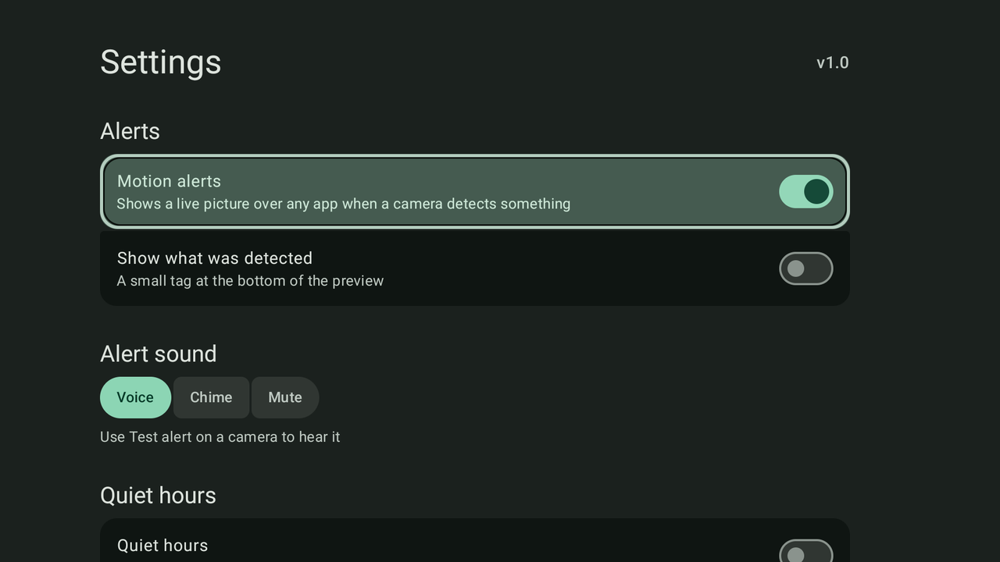
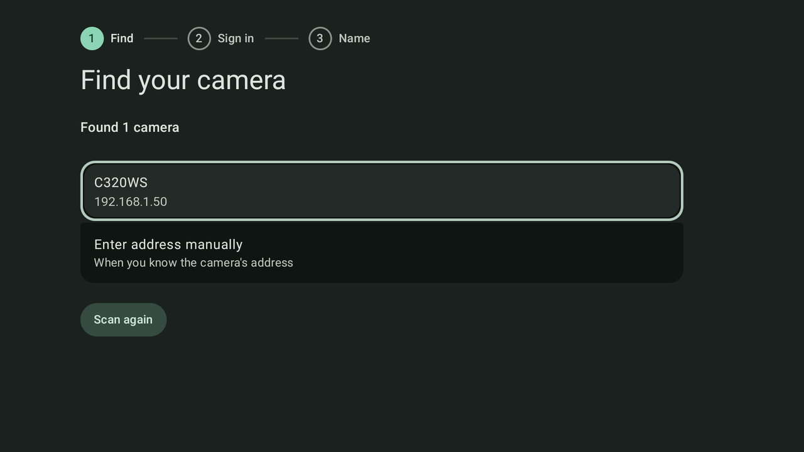
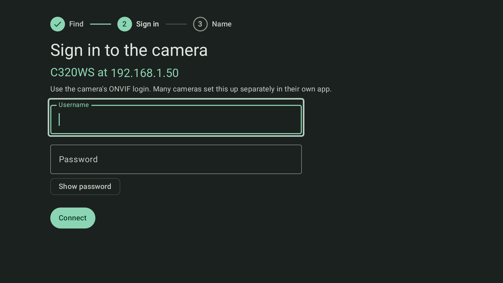
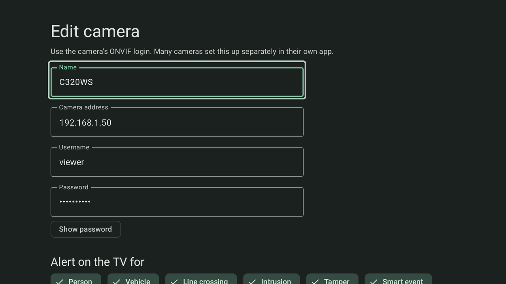
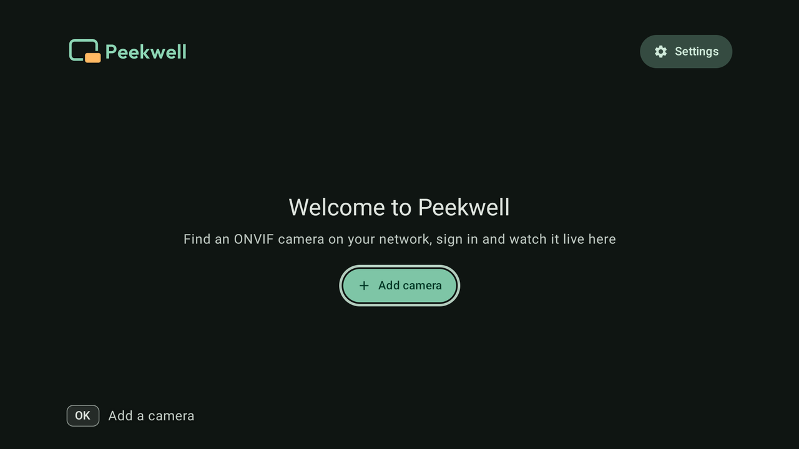

# Peekwell

<picture>
  <source media="(prefers-color-scheme: dark)" srcset="docs/logo-dark.svg">
  
</picture>

**Your home cameras, on the TV you're already watching.**

Peekwell is an open-source Android TV and Google TV app for ONVIF cameras. It finds the cameras on your home
network, plays them live, and when someone comes to the door it pops up a small live picture over whatever you're
watching and says what it saw. There's no cloud and no account: the TV talks straight to your cameras, and nothing
leaves your network.

<p>
  
  
  
  
  
  
</p>

## Features

- **Live grid** of every camera, muted. **Full screen** with sound; Left and Right switch cameras.
- **Finds your cameras**: ONVIF discovery shows each camera's model and address. Adding one takes three short
  steps: pick it, sign in, name it, with a live preview before you save.
- **Alerts over any app** (optional): a live picture slides in from the corner for 20 seconds, labelled with what
  the camera detected (Person, Vehicle, Line crossing, Motion and more). It's announced by voice, a chime, or
  silently.
- **You choose which detections alert**, per camera, from the list the camera itself reports.
- **Quiet hours** make alerts softer at night.
- **Built for the remote**: everything works with the D-pad, with a clear focus ring, and a hint bar says what OK
  does.
- **Recovers by itself**: reconnects dropped video, survives camera reboots and Wi-Fi drops, starts at boot, and
  follows a camera to its new address when the router changes it.
- **Private**: camera logins are stored only on the TV, in the app's private storage.

## Requirements

- **TV**: Android TV or Google TV running Android 8.0 (API 26) or newer.
- **Camera**: any camera with ONVIF turned on, on the same network as the TV. Live video needs RTSP, which every
  ONVIF camera provides. Alerts also need the camera to send ONVIF motion or detection events (most do; check yours
  with **Test alert**).

## Install

1. Download `peekwell-<version>.apk` from the [latest release](../../releases/latest).
2. On the TV, turn on **Developer options → USB debugging** (in Settings → System → About, press OK on
   **Android TV OS build** seven times to show Developer options).
3. From a computer on the same network, with [adb](https://developer.android.com/tools/releases/platform-tools)
   installed:

   ```bash
   adb connect <tv-ip>:5555                 # accept the "Allow USB debugging?" prompt on the TV
   adb install peekwell-<version>.apk
   adb shell appops set com.bytefoss.peekwell SYSTEM_ALERT_WINDOW allow   # lets alerts pop up over other apps
   ```

4. Switch USB debugging off again.

Any other sideloading tool works too. The last command is only needed for alerts, on TVs that have no settings
screen for the "Display over other apps" permission (most don't).

## Getting started

1. **Turn on ONVIF on each camera** and note its ONVIF username and password. Many cameras set this login up
   separately in their own app, and it's often not the login for that app.
2. Open **Peekwell** and choose **Add camera**:
   1. **Find**: pick your camera from the list, or **Enter address manually** (`192.168.1.50`, or
      `192.168.1.50:8080` for a camera on another port).
   2. **Sign in** with the camera's ONVIF login and choose **Connect**.
   3. **Name**: see it live, pick a name (Front door, Garage, ... or your own) and the detections that should alert,
      then **Add camera**.
3. On the grid, **OK** opens a camera full screen, and **Hold OK** edits it. **Settings**, at the top right, turns
   alerts on and sets the alert sound and quiet hours.

### Motion alerts

Alerts are **off by default**. Turn on **Motion alerts** in Settings. When a camera detects something, a small live
picture slides in over whatever is playing, with a tag saying what was detected, and stays until 20 seconds after
the last detection.

| Camera event | Tag | Spoken |
| --- | --- | --- |
| `IsPeople` | **Person** | "Person detected" |
| `IsVehicle` | **Vehicle** | "Vehicle detected" |
| `IsLineCross` | **Line crossing** | "Line crossing detected" |
| `IsIntrusion` | **Intrusion** | "Intrusion detected" |
| `IsTamper` | **Tamper** | "Camera tampering detected" |
| `IsMotion` | **Motion** | "Motion detected" |

When several come together, the highest in the table wins. A detection Peekwell has no name for is shown under
the camera's own name (`IsFace` becomes "Face"). With more than one camera, the camera's name is added: "Person
detected at Front door". Each visit is announced once, and again only if something more important turns up.

- **Alert sound**: **Voice** (the TV's text-to-speech, using a voice installed on the TV so it never waits on the
  internet), **Chime** or **Mute**. Sounds play on top of what you're watching without pausing it.
- **Alert on the TV for**, on each camera's edit screen: which of that camera's detections the TV reacts to. The
  camera's own app still decides what it detects (draw the line or area there for line crossing and intrusion).
- **Quiet hours** (off by default, 23:00 to 07:00): the pop-up still shows, and the sound becomes Chime or Mute.
- **Test alert**, on a camera's edit screen, shows its pop-up and plays its sound now, to check volume and
  permission.

While alerts are on, a small foreground service waits for the cameras' events and starts again at boot. When
alerts are off, nothing runs in the background.

## Build from source

You need:

- **JDK 21**. Android Studio's bundled one works:
  `export JAVA_HOME="/Applications/Android Studio.app/Contents/jbr/Contents/Home"` on macOS.
- **The Android SDK with platform 37** (Android Studio → SDK Manager, or `sdkmanager "platforms;android-37.0"`).
  Point the build at it with `ANDROID_HOME`, or a `local.properties` file containing `sdk.dir=/path/to/sdk`.

Then:

```bash
git clone https://github.com/bytefoss/peekwell.git
cd peekwell
./gradlew testDebugUnitTest     # 41 unit tests against a fake ONVIF camera, about 20 s
./gradlew assembleRelease       # app/build/outputs/apk/release/app-release.apk
./install.sh <tv-ip>            # builds, installs on the TV over adb and grants the pop-up permission
```

`install.sh` needs `adb` on your `PATH` and USB debugging on the TV, as in [Install](#install).

The Gradle wrapper downloads the right Gradle (9.8) by itself. The app is Kotlin with Jetpack Compose and
Material 3 Expressive (material3 1.5, which needs compile SDK 37; the app targets API 36). Release builds are
shrunk with R8.

## Troubleshooting

| Problem | What to do |
| --- | --- |
| The camera isn't in the list | Choose **Enter address manually** with the camera's IP (your router's device list shows it). Check ONVIF is on in the camera's app. |
| "Wrong camera login" | Use the camera's **ONVIF** login, which is often a separate account set up in the camera's own app. |
| No pop-ups | Run the `appops` command from [Install](#install), then use **Test alert** on the camera. |
| A tile says alerts can't work | The tile says why: the camera refused the login, can't be reached, or another device is holding its events. Some cameras serve events to only one app at a time. |
| Alerts never come | The camera may not send ONVIF events, or the detection is off in the camera's own app. Run `adb logcat -s peekwell` and walk past the camera: a working camera logs `pull … IsMotion=true`. |
| A camera got a new address | Nothing to do: Peekwell finds it again by its ONVIF ID within a minute or two. |

## How it works

| File | Role |
| --- | --- |
| `MainActivity` | The grid: each camera's small stream, muted |
| `PlayerActivity` | Full screen: the camera's full-resolution stream with sound |
| `SetupActivity` | Add, edit, test and delete a camera; Settings |
| `Theme` | The Material 3 Expressive theme and colours, the focus ring for the remote, live video with its loader |
| `Live` | Media3 ExoPlayer over RTSP (TCP) with a half-second buffer: quick retries for 10 s, then every 30 s |
| `Onvif` | A small ONVIF client: discovery, login (WS-Security, HTTP Digest), where the video and events are, pull-point events |
| `Watcher` | One camera's event loop: subscribe, renew, retry, release. Plain Kotlin, so it's unit-tested |
| `MotionService` | Runs a `Watcher` per camera and decides when an event starts a new visit |
| `Overlay`, `Announcer` | The pop-up with live video, and the spoken announcement with a chime fallback |
| `Cam` | A saved camera and the app's settings; follows a camera to a new address by its ONVIF ID |
| `CamApp`, `BootReceiver` | Keep a video player crash from stopping alerts; start alerts after boot |
| `FakeCamera` (tests) | A local stand-in camera with real cameras' quirks, used by `WatcherTest` |

When you add a camera, Peekwell asks it where its video and events are (ONVIF `GetCapabilities`, `GetProfiles`,
`GetStreamUri`) and what it can detect (`GetEventProperties`). Full screen uses the camera's largest video
profile; the grid and the pop-up use its smallest.

<details>
<summary>Camera quirks Peekwell handles</summary>

Cameras don't all follow ONVIF to the letter. These were all seen on real hardware:

- Writing each event's `Value` before its `Name`.
- Serving only one event subscription at a time. One left behind by an app that was killed blocks every new one
  until it expires, so Peekwell asks for 40-second subscriptions, renews them every 10 seconds and releases its
  subscription whenever it stops.
- Dropping the first request for events after subscribing. Peekwell retries on the same subscription and only
  starts over after 3 failures in a row.
- Answering about 40 times a second with the same event while someone is in view. Peekwell waits a second between
  requests while events are coming in.
- Sending detections it doesn't list (a vehicle on a "smart event" topic). They're added to the camera's choices.
- Ending the video stream without an error. The player is rebuilt and the stream restarted.

When events fail, Peekwell keeps trying: every 5 s while a leftover subscription is in the way, after 5 s doubling
up to 30 s while the camera is unreachable, and every 5 minutes after a refused login, so a wrong password can't
lock the camera's account.

</details>

<details>
<summary>Measured recovery times</summary>

| Situation | Alerts working again after |
| --- | --- |
| Cold start | 9 s |
| App killed mid-request, started again | 43–46 s (the leftover subscription expires) |
| Camera dropped off the network and came back | 22 s after it was back |
| TV lost Wi-Fi in standby | as soon as the network returned |
| TV restarted | 62 s after the restart, without opening the app |

The pop-up's video appears 0.3–0.5 s after an alert, and the announcement starts within about 10 ms.

</details>

## Tested with

A TCL 43P755 (Google TV, Android 12) and a TP-Link Tapo C320WS camera (hardware 2.0, firmware 1.6.6). Other ONVIF
cameras should work. If you try one, please open an issue saying whether it worked, with the camera's make and
model.

## Contributing

Bug reports, camera compatibility reports and pull requests are welcome. Please run `./gradlew testDebugUnitTest`
before sending a pull request, and say which TV and camera you tested on. Never paste camera passwords, or logs
with stream URLs in them, into an issue.

## Licence

Peekwell is licensed under the [Apache License 2.0](LICENSE).

- Video playback: [AndroidX Media3](https://github.com/androidx/media), Apache License 2.0
- Icons: [Material Symbols](https://fonts.google.com/icons), Apache License 2.0
- The Peekwell wordmark is drawn from [Outfit](https://github.com/Outfitio/Outfit-Fonts), SIL Open Font License 1.1.
